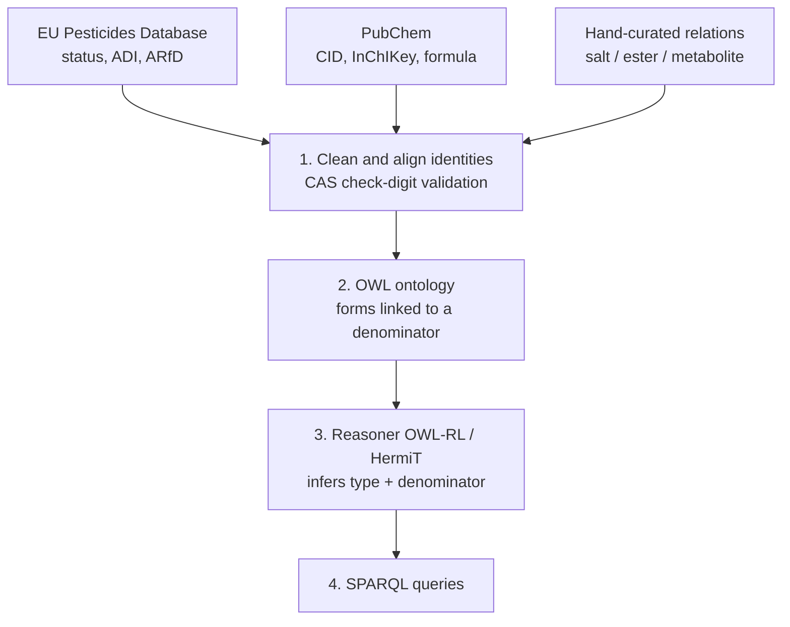
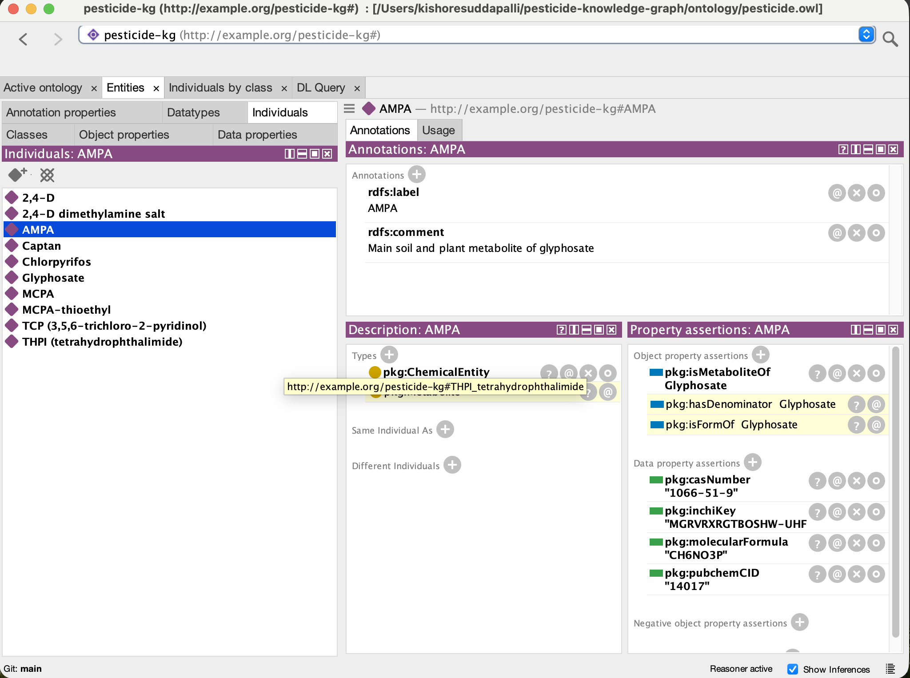
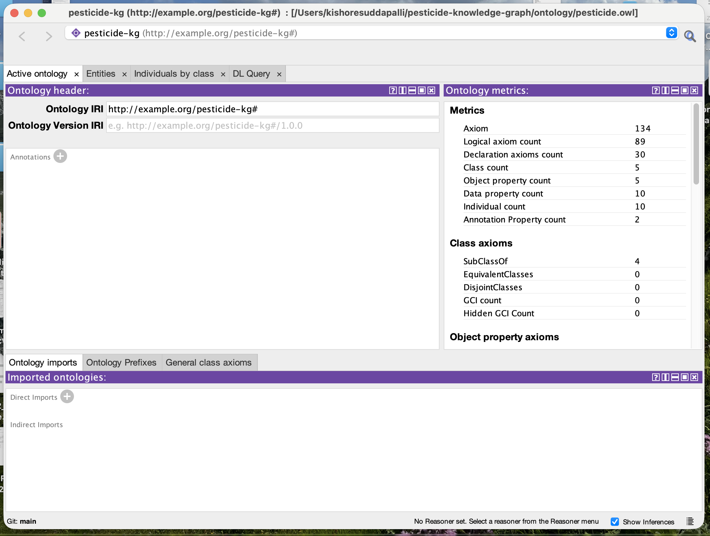

# Pesticide Knowledge Graph

A small, working ontology that links the **regulatory**, **chemical identity** and **analytical** views of pesticides, so that a salt, ester or metabolite found by a lab can be traced automatically to its active substance, its EU approval status and its toxicological limits.

Built with Python, rdflib, OWL and SPARQL on public EU and PubChem data. The design is inspired by the *denominator* concept in Gentile et al., *An AI-Assisted Semantic Platform enabling Pesticide Risk Assessment* (Nestlé Research, SEMANTiCS 2026, [CEUR-WS Vol-4293](https://ceur-ws.org/Vol-4293/paper19.pdf)).

## The problem

The same chemical appears in different forms and under different names across sources. A substance may be **approved** as an acid, **sold** as a salt or ester, and **detected** in food as a metabolite. Without explicit links, a lab result for AMPA says nothing about glyphosate's approval status or limits.

## What this project does



1. **Clean** the EU active-substance export (1,485 substances), validate every CAS number and repair what can be repaired safely.
2. **Align identities** with PubChem (CID, InChIKey, formula).
3. **Build an OWL ontology** where `isSaltOf`, `isEsterOf` and `isMetaboliteOf` are sub-properties of `isFormOf`, which is a sub-property of `hasDenominator`.
4. **Reason**: from one stated fact ("AMPA isMetaboliteOf Glyphosate") the reasoner infers that AMPA *is a Metabolite* and that its *denominator is Glyphosate*.
5. **Query** the result with SPARQL.

## The reasoner at work

Only `isMetaboliteOf Glyphosate` was written by hand. The facts on a yellow background were inferred by HermiT in Protégé:





## Results

**Q2. A lab detected CAS 1066-51-9: which active substance is it, is it approved, what are its limits?**

| detected | formType   | activeSubstance | status   | ADI (mg/kg bw/d) | ARfD (mg/kg bw) | approval expires |
|----------|------------|-----------------|----------|-----|------|------------|
| AMPA     | Metabolite | Glyphosate      | Approved | 0.5 | 1.5  | 2033-12-15 |

**Q3. Which salts, esters or metabolites belong to a substance that is NOT approved in the EU?**

| form | type | activeSubstance | status |
|------|------|-----------------|--------|
| TCP (3,5,6-trichloro-2-pyridinol) | Metabolite | Chlorpyrifos | Not approved |

TCP carries no status of its own; it inherits the risk flag through its denominator.

**Q4. Facts added by the reasoner (not written by hand)**

| form | is a | hasDenominator |
|------|------|----------------|
| 2,4-D dimethylamine salt | Salt | 2,4-D |
| AMPA | Metabolite | Glyphosate |
| MCPA-thioethyl | Ester | MCPA |
| TCP (3,5,6-trichloro-2-pyridinol) | Metabolite | Chlorpyrifos |
| THPI (tetrahydrophthalimide) | Metabolite | Captan |

Q1 (all forms of MCPA) and the full outputs are in [`results/`](results/).

## Data-quality findings

Validating the official EU export before modelling it surfaced real identity problems:

| Finding | Count |
|---|---|
| Active substances in the export | 1,485 (421 approved, 980 not approved, 84 pending) |
| No CAS number at all ("No CAS allocated" etc.) | 412 (28%) |
| CAS given only inside a free-text remark | 4 (e.g. MCPA: "see remark") |
| Typo repaired automatically (`133-06-02` → `133-06-2`, captan) | 1 |
| Fixed by hand after check-digit validation | 3 (carvone, fuberidazole, paraffin oil) |
| Still invalid | 1 |

Every manual fix is documented with its reason in [`data/manual/cas_corrections.csv`](data/manual/cas_corrections.csv).

**Example:** MCPA's CAS cell says "see remark". The remark lists a second number, `25319-90-8`, which PubChem identifies as **MCPA-thioethyl**. The pipeline found it, validated it, identified it and linked it to MCPA as an ester. That is the denominator problem in miniature.

## Repository structure

```
src/
  01_select.py       clean the EU export, validate CAS numbers
  02_align_ids.py    merge PubChem identities
  03_build_owl.py    build the OWL ontology and run the OWL-RL reasoner
  04_query.py        run the SPARQL queries, save results
queries/             the four SPARQL queries (.rq)
data/manual/         hand-curated relations and CAS corrections, each with a source
ontology/            pesticide.ttl, pesticide.owl (Protégé), pesticide_inferred.ttl
results/             query outputs as Markdown
docs/images/         Protégé screenshots
```

## How to run

```bash
pip install -r requirements.txt
# put the EU active-substance export in data/raw/active_substances.xlsx
# put one PubChem CSV per CAS in data/raw/pubchem/<CAS>.csv
python src/01_select.py
python src/02_align_ids.py
python src/03_build_owl.py
python src/04_query.py
```

Open `ontology/pesticide.owl` in [Protégé](https://protege.stanford.edu) and start the HermiT reasoner to see the inferred facts.

## Data sources

- [EU Pesticides Database](https://food.ec.europa.eu/plants/pesticides/eu-pesticides-database_en), active-substance export (17 Nov 2026)
- [PubChem](https://pubchem.ncbi.nlm.nih.gov/), compound properties via PUG REST
- Relations (salt / ester / metabolite) curated by hand, with the source of each in `data/manual/relations.csv`

## Limitations

- 5 active substances and 5 related forms: a proof of concept, not full coverage.
- Relations are curated by hand; regulatory residue definitions (which forms are summed for an MRL) are not yet modelled.
- No food or lab-result layer yet.

## Next steps

- **Map EFSA monitoring data** ([Zenodo](https://zenodo.org/record/1323511), SSD2 format) to the ontology. Substances and foods are coded with EFSA's PARAM and FoodEx2 catalogues, so the next step is aligning those codes to the ontology concepts.
- **Reuse existing vocabularies**: align substances to ChEBI and foods to FoodOn instead of local IRIs.
- **Model residue definitions** and MRLs per food.
- **Entity linking** from free text (lab reports, regulatory documents) to ontology concepts with an NLP model.

## Author

Kishore Tambi Suddapalli · MSc Artificial Intelligence student · kishoresuddapalli8@gmail.com
